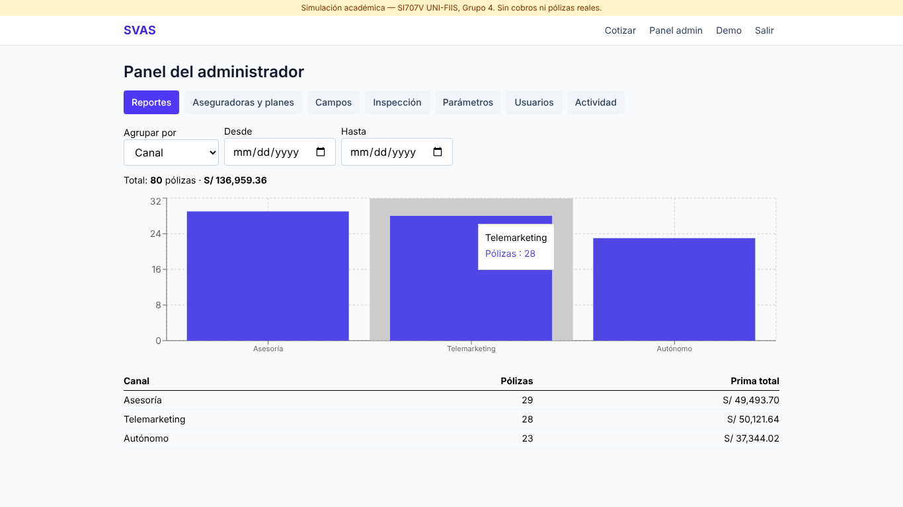
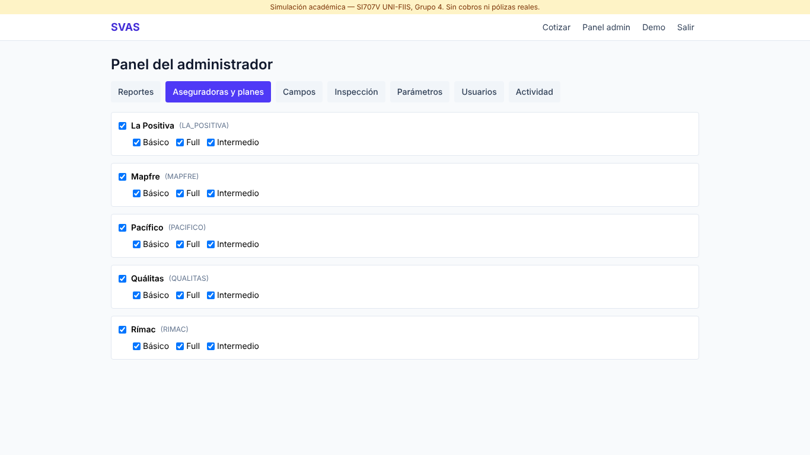
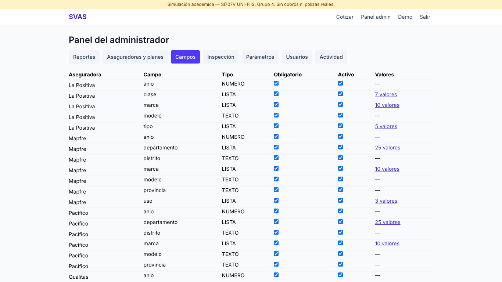
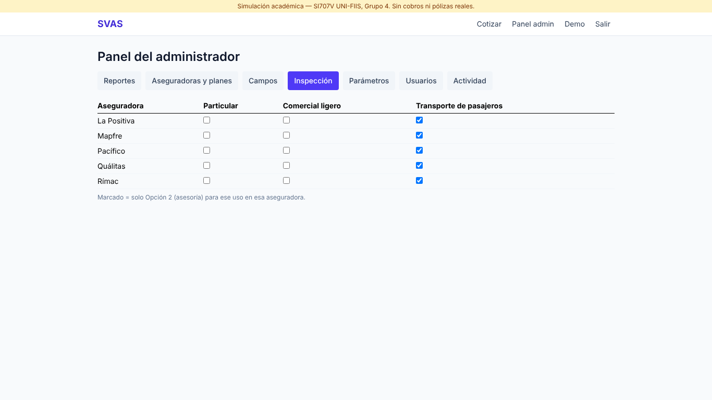
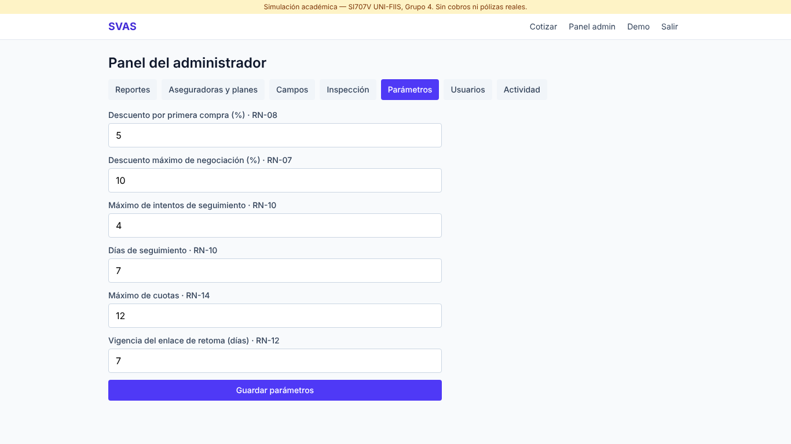
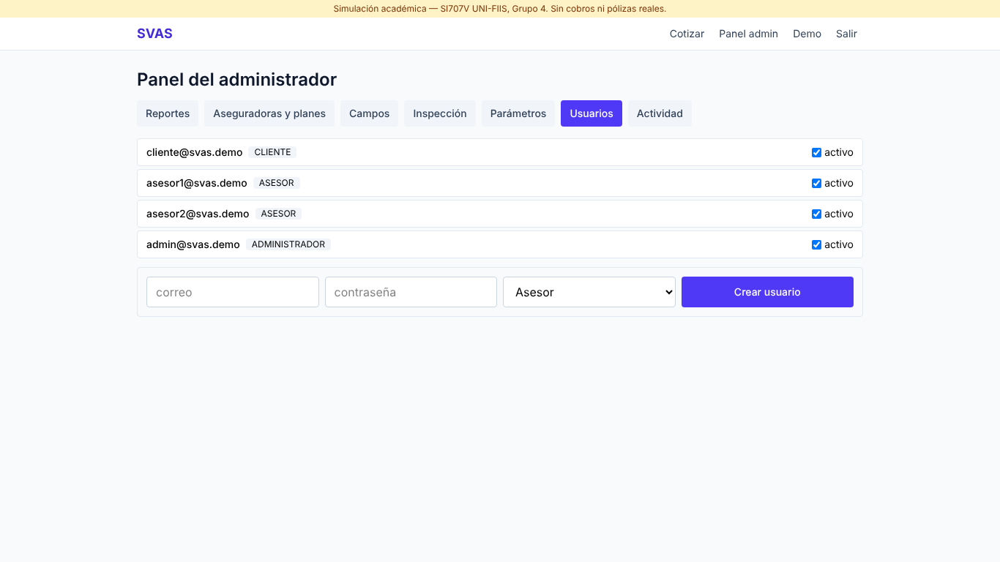
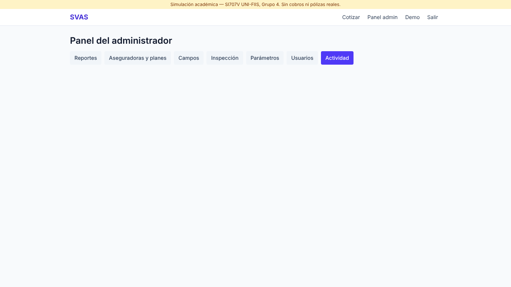
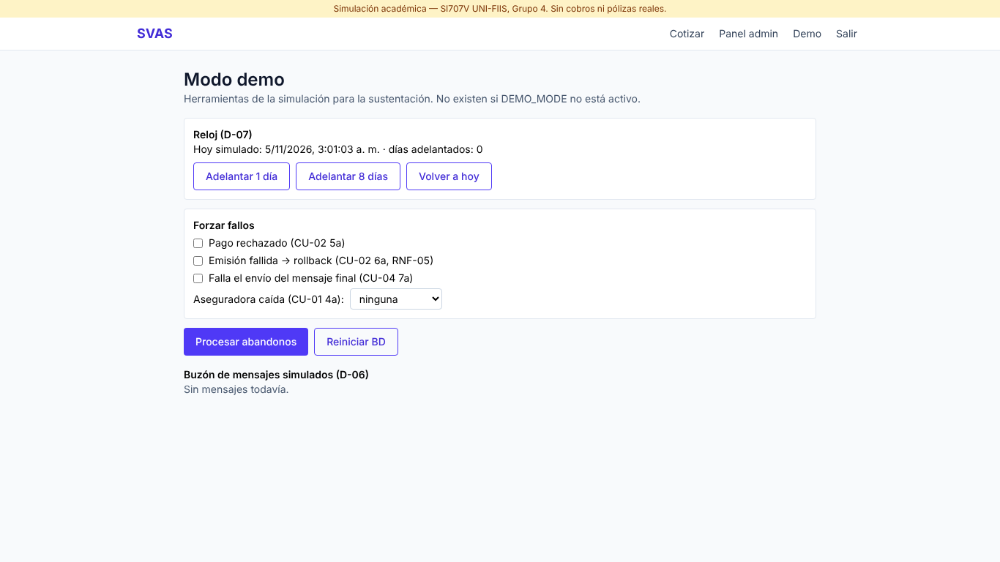

# Manual del administrador SVAS

> **Simulación académica** (SI707V UNI-FIIS, Grupo 4). Todo lo de este manual se cambia **desde la pantalla, sin tocar código** (RNF-13). Cada cambio queda en la actividad con usuario y fecha (RNF-12).

## 0. Instalación y arranque (Windows, PowerShell)
Ver `README.md`. Resumen:
```powershell
npm install
Copy-Item apps\api\.env.example apps\api\.env   # ajustar la clave de PostgreSQL
npm run db:reset                                # migraciones + datos de demo
npm run build
npm start                                       # http://localhost:3000
```
Usuario inicial: `admin@svas.demo` / `Admin123!`. En el menú: **Panel admin**.

## 1. Reportes — RF-30
Pólizas emitidas y prima total por **canal** (autónomo, asesoría, telemarketing), **aseguradora** o **plan**, filtrando por fecha de emisión (desde/hasta). Gráfico de barras y tabla.



## 2. Aseguradoras y planes — RF-27, RN-16
Marca o desmarca para **activar/desactivar** una aseguradora o un plan. Lo desactivado deja de aparecer en las cotizaciones **nuevas** al instante; las cotizaciones y pólizas anteriores se conservan (no se borra nada).
> Agregar una aseguradora nueva sí requiere una clase de estrategia en el código (patrón Strategy, RNF-14).



## 3. Campos del formulario — RF-28, RN-17
- Cada fila es un campo que pide una aseguradora. El formulario del cotizador es la **unión** de los campos de las aseguradoras activas; un campo es obligatorio si alguna lo exige.
- **Obligatorio / Activo**: casillas.
- **Valores** (campos de lista): pulsa «N valores», edítalos separados por coma y **Guardar**.
- **Agregar campo**: aseguradora, nombre (minúsculas, p. ej. `color`), tipo (texto, número o lista), valores y si es obligatorio. Aparece en el formulario al instante y su valor se guarda con el vehículo.
> Uso, marca, modelo y año se piden siempre (son la base del cálculo).



## 4. Inspección — RF-29, RN-25
Matriz aseguradora × uso. Marcado = ese uso en esa aseguradora **exige inspección**: el plan solo se vende con asesoría (Opción 2) y el caso se deriva solo a la cola.



## 5. Parámetros comerciales — RF-29
| Parámetro | Inicial | Efecto |
|---|---|---|
| Descuento por primera compra | 5 % | Se aplica si el DNI no tiene póliza previa (RN-08) |
| Descuento máximo de negociación | 10 % | El asesor no puede registrar más (RN-07); también es el tope de cualquier descuento (RN-09) |
| Máximo de intentos de seguimiento | 4 | RN-10 |
| Días de seguimiento | 7 | RN-10 |
| Máximo de cuotas | 12 | RN-14 (mínimo 2) |
| Vigencia del enlace de retoma | 7 días | RN-12 |

Los valores fuera de rango se rechazan con el error en el campo.



## 6. Usuarios — RF-31
Crear asesores o administradores (correo, contraseña de 8+ caracteres, rol) y activar/desactivar cuentas. Desactivar corta el acceso **al instante**. No puedes desactivar tu propia cuenta ni dejar el sistema sin administradores.



## 7. Actividad — RNF-12
Últimas acciones críticas: cotizaciones, descuentos, intentos, pagos, emisiones y cambios de catálogo o parámetros, con usuario (o «invitado / sistema») y fecha.



## 8. Modo demo (solo si `DEMO_MODE=true`) — F8
Menú **Demo** (solo administradores). Herramientas para la sustentación:
- **Reloj**: adelantar 1 u 8 días / volver a hoy (para mostrar el seguimiento de 7 días y el enlace vencido).
- **Forzar fallos**: pago rechazado, emisión fallida (rollback), falla del mensaje final, aseguradora caída.
- **Procesar abandonos**: lleva a seguimiento las cotizaciones sin compra (lo mismo que hace el proceso automático cada minuto).
- **Buzón**: los mensajes que el sistema «habría enviado», con su enlace.
- **Reiniciar BD**: vuelve a los datos de demo (cierra la sesión).

Con `DEMO_MODE=false` (en `apps/api/.env`) estas herramientas no existen.



## 9. Guion de demo
Ver `docs/GUIA_DEMO.md` (10 pasos). Ensayo automático: con la app corriendo, `node scripts/guion-demo.cjs capturas-demo`.
