# Manual de usuario SVAS (cliente y asesor)

> **Simulación académica** (SI707V UNI-FIIS, Grupo 4): no hay cobros reales ni pólizas con validez legal. Las tarifas, los DNI y las personas son ficticios.
> Nunca se pide número de tarjeta, CVV ni datos bancarios: el pago es un botón simulado.

Dirección: http://localhost:3000 (o la URL publicada). Funciona en celulares desde 360 px de ancho.

---

## Parte 1 · Cliente

### 1. Cotizar (sin cuenta) — CU-01
1. En el menú, **Cotizar**.
2. Completa los datos del vehículo. Los campos con * son obligatorios; el formulario se arma con lo que piden las aseguradoras activas.
3. Completa tu contacto: nombres, celular (9 dígitos que empiezan en 9) y el canal por el que prefieres que te contactemos (WhatsApp o Llamada). El correo es **opcional**.
4. Pulsa **Ver precios**. Si algún dato está mal, el error aparece debajo del campo y no pierdes lo escrito.

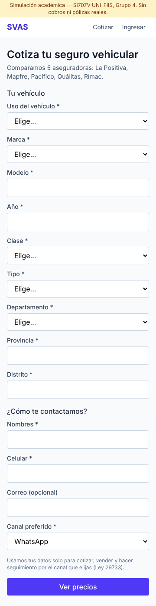

### 2. Comparar
- Verás una tarjeta por cada aseguradora y plan, ordenadas de menor a mayor precio (puedes ordenar por aseguradora).
- Cada plan tiene dos opciones: **Comprar ahora** (compra en línea, sin llamada de un asesor) y **Prefiero que me asesoren**.
- Si una aseguradora no cotiza tu vehículo en línea, se indica arriba («No cotizan en línea…»), y el resto se muestra igual.

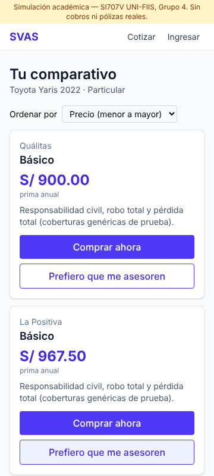

**Casos especiales**
| Situación | Qué verás |
|---|---|
| Ninguna aseguradora cotiza tu vehículo (p. ej. muy antiguo) | «Tu caso pasó a un asesor»: te contactarán por tu canal preferido; no necesitas dejar tu correo |
| Taxi, colectivo o apps (transporte de pasajeros) | «Comprar ahora» aparece deshabilitado («Requiere inspección»): la compra se hace con asesoría |
| Camión, bus o remolcador, o más vehículos de los permitidos | «No podemos cotizar este vehículo aquí» (fuera del alcance de la plataforma) |

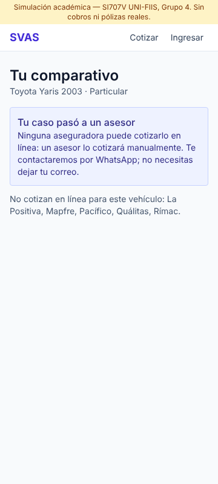 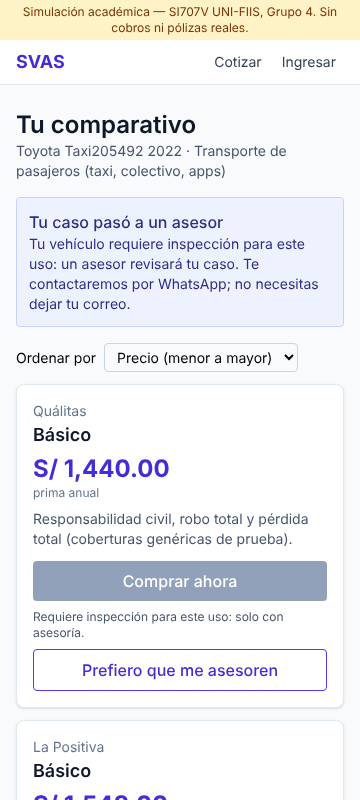

### 3. Comprar ahora (sin asesor) — CU-02
1. En el plan elegido pulsa **Comprar ahora**. Verás el resumen.
2. **Ingresa** o **crea tu cuenta** (registro mínimo). Tu cotización se conserva.
3. Solo te pedimos lo que falta para emitir: **DNI** y **apellidos**. Si es tu primera póliza con ese DNI, se aplica automáticamente el **descuento por primera compra**.
4. Elige **Pago único** o **En cuotas** (sin recargo), acepta las condiciones y firma (firma simulada). Pulsa **Ver cronograma**.
5. Pulsa **Pagar (simulado)**. Si el pago es rechazado, puedes reintentar o cambiar la forma de pago.
6. Al confirmarse, se emite la póliza y puedes **Descargar póliza (PDF)**. El PDF dice «Documento de demostración sin validez legal».

| | | |
|---|---|---|
| 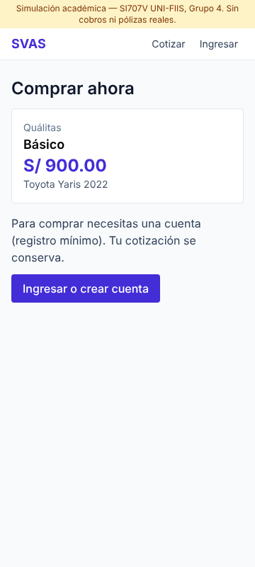 | 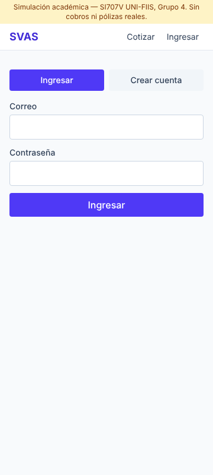 | 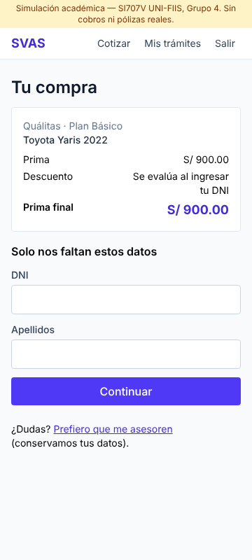 |
| 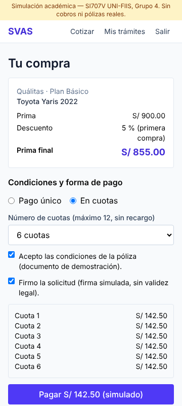 | 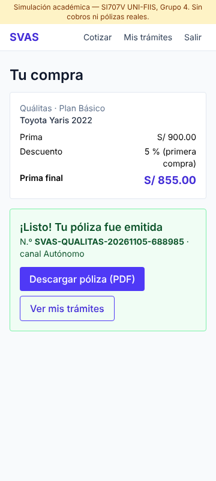 | 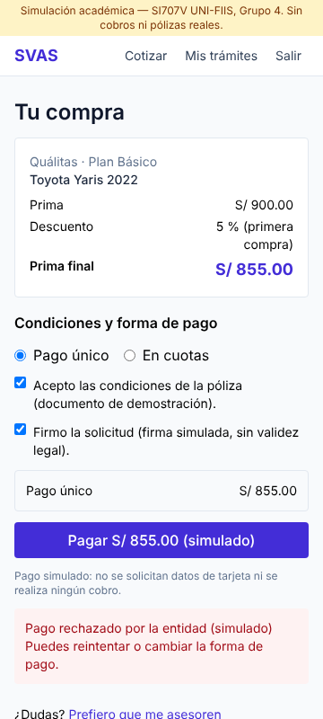 |

### 4. Pedir asesoría o un descuento — CU-03
1. En un plan pulsa **Prefiero que me asesoren**. Tus datos ya están cargados.
2. Elige el motivo (dudas, negociar el precio, descuento) y el canal de contacto.
3. Ingresa o crea tu cuenta y pulsa **Solicitar asesoría**. Verás el tiempo estimado en que te contactarán.
4. Si el asesor te ofrece un descuento y lo aceptas, vuelve al comparativo (desde **Mis trámites**) y usa **Comprar ahora**: el descuento ya estará aplicado. Los descuentos no se suman: se aplica el mayor.

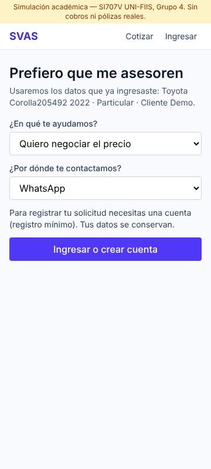 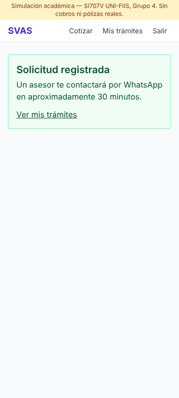

### 5. Retomar la compra desde el mensaje — CU-04
Si cotizaste y no compraste, un asesor puede contactarte. Al cerrar el caso recibirás **un único mensaje** con un enlace para retomar la compra (con tu descuento de primera compra, si aplica). El enlace **vence a los 7 días**; si venció, puedes volver a cotizar.

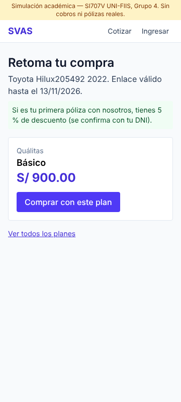 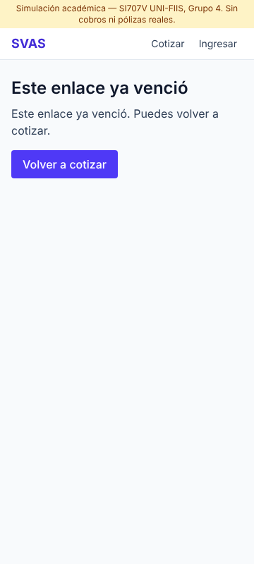

### 6. Mis trámites — RF-26
En **Mis trámites** ves el estado de cada cotización, de la asesoría, del pago (cuotas pagadas/pendientes) y de la póliza, con su vigencia y el botón para descargar el PDF.

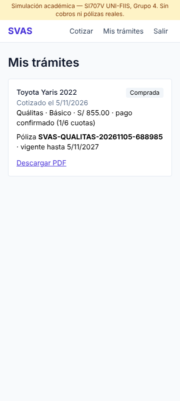

---

## Parte 2 · Asesor

Ingresa con tu cuenta de asesor (la crea el administrador). En el menú: **Panel asesor**. Tiene dos pestañas.

### 7. Asesoría — CU-03
- La **cola** muestra primero los casos **derivados por el sistema** (inspección, no asegurable; etiqueta «Derivado») y luego los que pidieron los clientes, cada grupo por orden de llegada.
- **Abrir** → ves el vehículo, el contacto y el canal por el que debes contactar, y todas las primas, sin pedirle nada de nuevo al cliente.
- **Tomar caso** → queda a tu nombre (otro asesor ya no puede tomarlo).
- **Prima manual**: solo en casos derivados y en planes que no tienen prima en línea.
- **Descuento**: elige el plan y el %; el sistema rechaza cualquier valor mayor al máximo configurado (por defecto 10 %).
- **Resultado**: *Cliente acepta* (habilita la compra con el descuento; la venta se registra como canal Asesoría), *No acepta* o *No responde* (la cotización pasa a seguimiento).

| | |
|---|---|
| 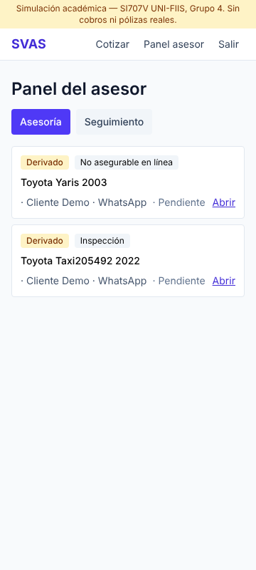 | 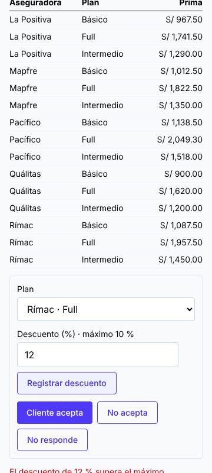 |

### 8. Seguimiento — CU-04
- La cola muestra las cotizaciones no concretadas, con los intentos hechos y los que quedan, y el plan sugerido.
- Solo puedes registrar intentos **por el canal preferido del cliente**, hasta el máximo (por defecto 4 en 7 días). Al llegar al máximo sin respuesta, el caso se cierra solo.
- Si el cliente **acepta**, se le envía el enlace de retoma; si paga, el caso queda *Convertido* (canal Telemarketing).
- Si el cliente quiere negociar: **El cliente quiere negociar → crear solicitud de asesoría**.
- Para cerrar el caso debes elegir un **motivo** (precio, ya contrató, no responde, sin interés, otro). Al cerrar se envía **un único mensaje final** con el enlace; si el envío falla, aparece **Reenviar mensaje final**.

| | |
|---|---|
| 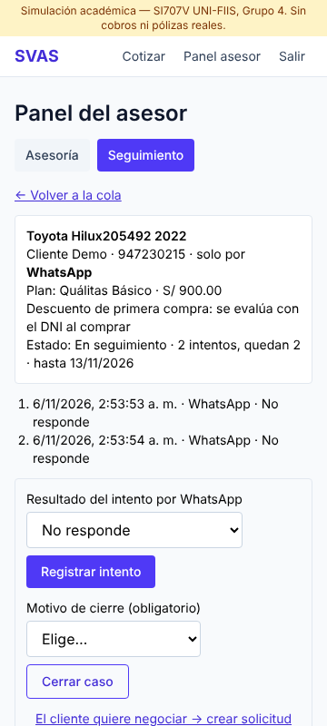 | 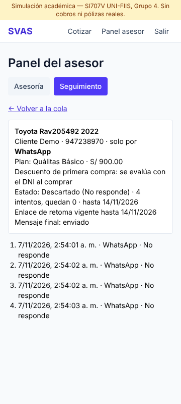 |

### 9. Lo que el asesor no puede hacer
El panel de administración está bloqueado para los asesores (la protección está en el servidor, no solo en el menú).

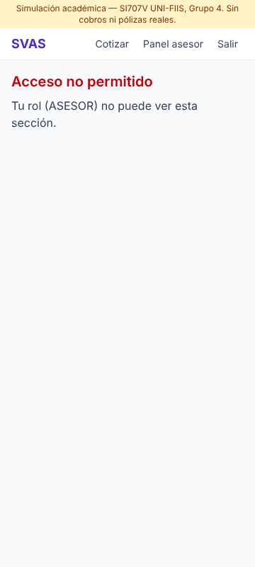
